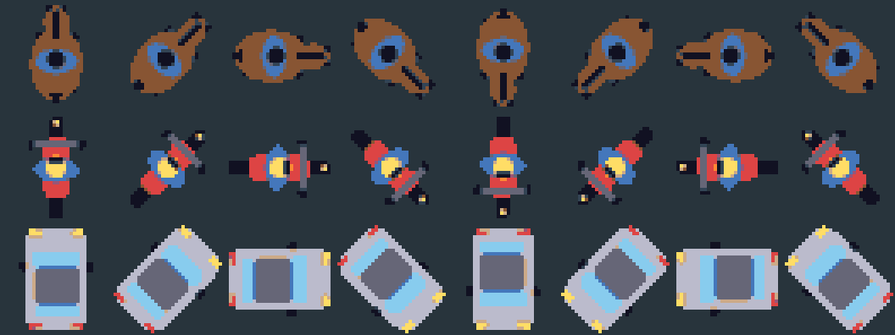

# SOI 45: Evolution Rush (CPE222 Final Project)

เกม top-down บน FPGA **Digilent Nexys A7** (Artix-7) แสดงผลผ่าน VGA 640×480 @ 60 Hz เขียนด้วย Verilog ใน Vivado 2024.2

ผู้เล่นเป็นนักศึกษา มจธ. ที่กำลังกลับหอ เริ่มจากขี่ม้า แล้วเก็บไอเทมเพื่อเปลี่ยนร่างเป็นมอเตอร์ไซค์และรถ Benz ตามลำดับ

> สถานะ: **Progress demo (20/11/2026)** มีเฉพาะ Feature 1 (Movable) และแกนหลักของ Feature 2 (Evolution)
> State diagram: https://claude.ai/artifact/VkE8fRPyqZFxZFGzGJRbZJ

## สิ่งที่อยู่ใน demo นี้

| Test | สิ่งที่ทำได้ | โมดูล |
|---|---|---|
| 1.1 เดินได้ 8 ทิศ | WASD / ลูกศรบน USB keyboard หรือปุ่ม BTNU/D/L/R; กดสองปุ่มพร้อมกันเพื่อเดินเฉียง; กดทิศตรงข้ามพร้อมกันจะหักล้างกัน | `ps2_rx`, `kbd_decoder`, `debounce`, `player_move` |
| 1.2 sprite เปลี่ยนทุกทิศ | `facing_fsm` (Moore, 8 state) ส่ง `dir` ไปเลือก frame ใน sprite ROM | `facing_fsm`, `sprite_rom` |
| 1.3 เดินไม่ตกแมพ | clamp ตำแหน่งให้อยู่ในถนน X 128–480, Y 48–448 | `player_move` |
| 2.1 ชนของแล้วของหาย | AABB collision → item state GONE | `item_slot` |
| 2.3 ชนของแล้ว sprite ของเปลี่ยน | item เปลี่ยนเป็น sparkle 20 frame ก่อนหาย | `item_slot` |
| 2.2 ชนของแล้วค่าประจำเปลี่ยน | counter +1 (แสดงบน HUD, LED[2:0], 7-seg) | `evolution` |
| 3.1 ครบ 3 ชิ้นแล้วเปลี่ยนร่าง | HORSE → BIKE → BENZ, counter reset | `evolution` |
| 3.2 ร่างใหม่ก็มี sprite ครบทุกทิศ | ROM เก็บ 3 ร่าง × 8 ทิศ: `addr = {form, dir, row, col}` | `sprite_rom`, `gen_sprites.py` |

## อุปกรณ์บนบอร์ดที่ใช้

| อุปกรณ์ | ขา FPGA | ใช้ทำอะไร | ใช้ใน demo |
|---|---|---|---|
| Clock 100 MHz | E3 | system clock; pixel 25 MHz ทำเป็น clock-enable หาร 4 | ✓ |
| CPU_RESETN (ปุ่มแดง) | C12 | reset เกม (active low) | ✓ |
| USB HID host → PS/2 (PIC24) | PS2_CLK F4, PS2_DATA B2 | USB keyboard: WASD / ลูกศร | ✓ |
| ปุ่ม BTNU / BTND / BTNL / BTNR | M18 / P18 / P17 / M17 | ใช้แทน keyboard (debounce 10 ms) | ✓ |
| ปุ่ม BTNC | N17 | (แผน) Start / Pause | – |
| VGA 12-bit (R,G,B 4 บิต + HS, VS) | R: A3 B4 C5 A4 · G: C6 A5 B6 A6 · B: B7 C7 D7 D8 · HS B11 · VS B12 | จอเกม 640×480 @ 60 Hz | ✓ |
| LED 16 ดวง | H17 … V11 | LED[2:0] จำนวนไอเทม · LED[7] toggle ทุกครั้งที่ได้ byte จาก keyboard · LED[11:8] ปุ่ม ขึ้น/ลง/ซ้าย/ขวา (debug) · LED[15:13] ร่างปัจจุบัน | ✓ |
| RGB LED16 | R N15, G M16, B R12 | สีของร่าง: ม้า=เหลือง, มอไซค์=น้ำเงิน, Benz=เขียว (PWM 1/16 ไม่ให้แสบตา) | ✓ |
| 7-segment 8 หลัก | CA–CG: T10 R10 K16 K13 P15 T11 L18 · DP H15 · AN0–7: J17 J18 T9 J14 P14 T14 K2 U13 | `F 1   C 2 05` = ร่าง / จำนวนในร่างนี้ / จำนวนรวม (hex) | ✓ |
| Switch 16 ตัว | J15 … V10 | (แผน) mute, debug hitbox, เลือกโหมดแสดงผล | – |
| Mono audio (PWM) | AUD_PWM A11, AUD_SD D12 | (stretch) เสียงเอฟเฟกต์ | – |
| Accelerometer ADXL362 | SPI | (ไม่ใช้) | – |

pin ทั้งหมดอยู่ใน [`constraints/nexys_a7.xdc`](constraints/nexys_a7.xdc) ซึ่งอิงจาก Digilent `Nexys-A7-100T-Master.xdc` (บอร์ด -50T ใช้ขาเดียวกัน)

### ข้อควรรู้เรื่อง USB keyboard
- เสียบที่ช่อง **USB HOST (J5)** ซึ่งต่างจากช่อง PROG/UART micro-USB
- PIC24 บนบอร์ดแปลง USB HID เป็น PS/2 (scan code set 2) และรองรับเฉพาะ keyboard/mouse ที่เป็น HID แท้ บาง keyboard ที่มี hub ในตัวหรือแบบ wireless dongle อาจใช้ไม่ได้
- ทดสอบ: กดปุ่มใดก็ได้แล้วดูว่า **LED7 กระพริบ** (มี byte เข้ามา) และกด W/A/S/D แล้ว LED11–8 ต้องติดตามปุ่ม
- ถ้า keyboard ใช้ไม่ได้ ให้ใช้ปุ่ม BTNU/BTND/BTNL/BTNR แทน (กดสองปุ่มพร้อมกันเพื่อเดินเฉียง)

## Build และโปรแกรมลงบอร์ด

ต้องมี Vivado 2024.2 (เวอร์ชันอื่นที่รองรับ Artix-7 ก็ใช้ได้)

```bash
# 1) (ทำเมื่อแก้ภาพเท่านั้น) สร้างไฟล์ sprite .mem ใหม่ ต้องมี Pillow
python scripts/gen_sprites.py

# 2) สร้าง project + bitstream (Nexys A7-100T)
vivado -mode batch -source scripts/build.tcl -tclargs bit
#    บอร์ด A7-50T:
vivado -mode batch -source scripts/build.tcl -tclargs bit xc7a50ticsg324-1L
#    สร้างแค่ project แล้วเปิด build/soi45.xpr ใน GUI:
vivado -mode batch -source scripts/build.tcl
```

bitstream ที่ได้อยู่ที่ `build/soi45.runs/impl_1/top.bit` ให้เปิด Vivado → Open Hardware Manager → Open Target → Auto Connect → Program Device

## โครงสร้าง repo

```
rtl/
  top.v                      top-level + renderer + LED/RGB
  input/      ps2_rx.v, kbd_decoder.v, debounce.v
  movable/    facing_fsm.v, player_move.v
  evolution/  item_slot.v, evolution.v, lfsr16.v
  graphics/   vga_sync.v, sprite_rom.v, palette.v
  peripherals/seg7_scan.v
constraints/nexys_a7.xdc
assets/sprite_mem/  player.mem (3 ร่าง × 8 ทิศ × 32×32), item.mem (4 frame)
assets/preview/     ภาพ preview ของ sprite
scripts/            gen_sprites.py, build.tcl
sim/tb_demo.v       testbench แบบเช็คผลเอง ครอบคลุม test list
```

## Sprite

`scripts/gen_sprites.py` วาด sprite ชั่วคราวด้วยโค้ด โดยวาดหันขึ้นที่ 128 px หมุนทีละ 45° แล้วย่อเป็น 32×32 และแปลงเป็นพาเลต 16 สี (index 0 = โปร่งใส) เมื่อมีภาพจริงแล้วให้แก้เฉพาะฟังก์ชัน `draw_*` ส่วน layout ของ `.mem` ใช้แบบเดิมได้




## เครดิต
- ขา FPGA อ้างอิงจาก Digilent Nexys A7 Master XDC และ Reference Manual
- VGA timing ตามมาตรฐาน VESA 640×480 @ 60 Hz
